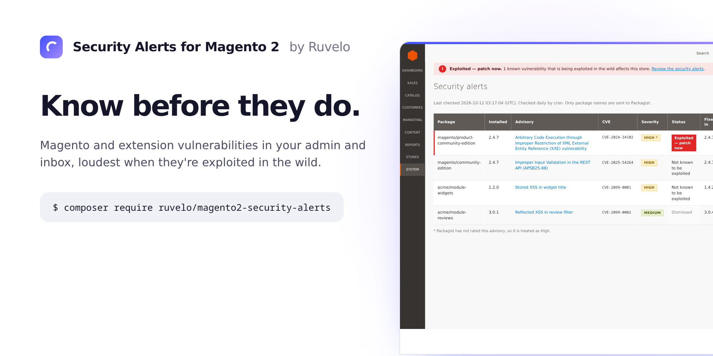
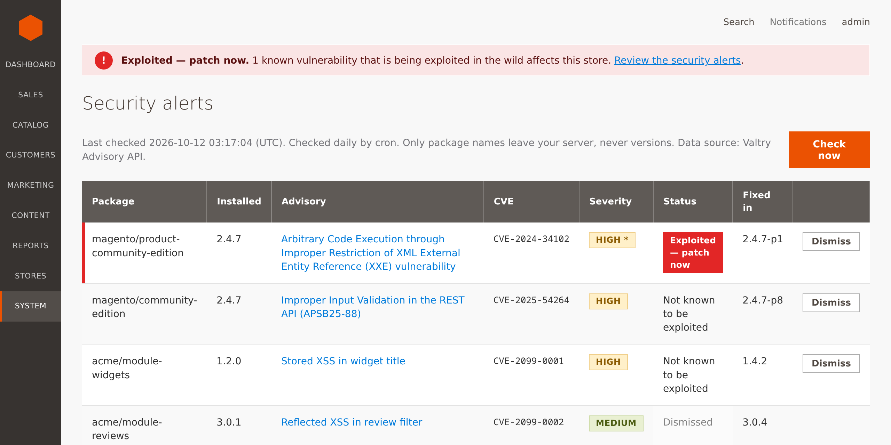
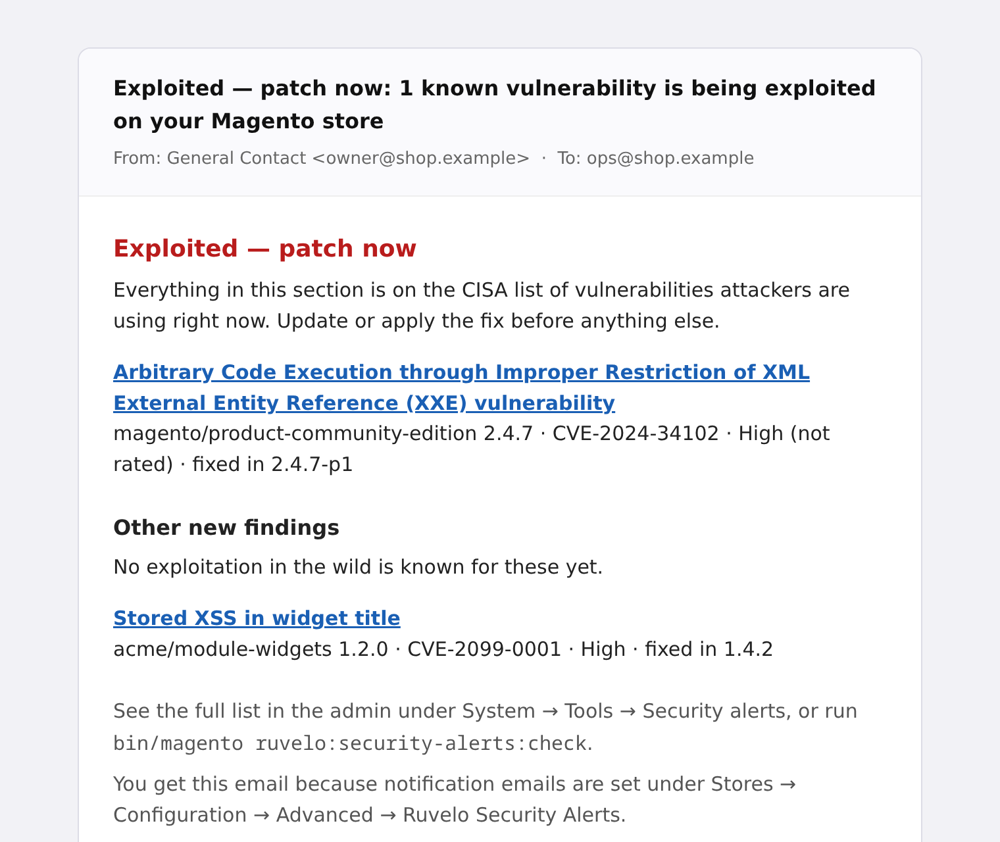
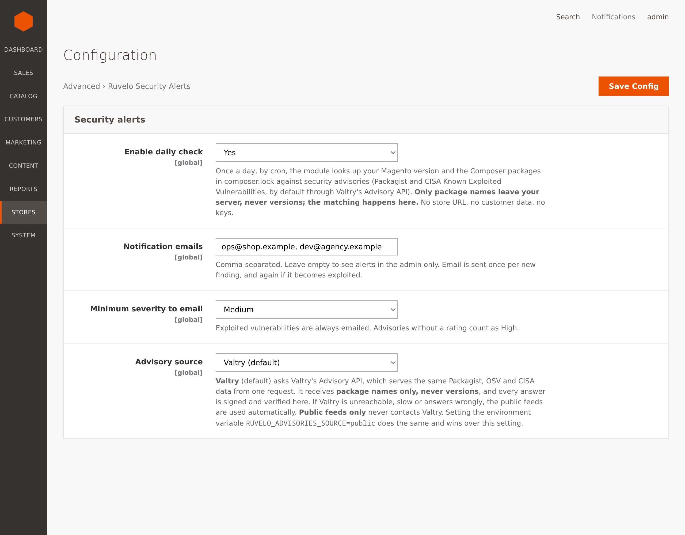

<p align="center">
  
</p>

<p align="center">
  <a href="#install"><strong>Install</strong></a> &nbsp;&nbsp;&nbsp;
  <a href="#configuration"><strong>Configuration</strong></a> &nbsp;&nbsp;&nbsp;
  <a href="#command-line"><strong>CLI</strong></a> &nbsp;&nbsp;&nbsp;
  <a href="#events"><strong>Events</strong></a> &nbsp;&nbsp;&nbsp;
  <a href="CHANGELOG.md"><strong>Changelog</strong></a>
</p>

<p align="center">
  <a href="https://github.com/Ruvelo/magento2-security-alerts/actions/workflows/tests.yml"></a>
  
  
  
  
  <a href="LICENSE"></a>
</p>

# Security Alerts for Magento 2

**Know before they do.** This module tells you, inside the Magento admin and by email, when the exact Magento version you run, or an extension you installed with Composer, has a known vulnerability. When the flaw is **exploited in the wild**, it says so loudly: "Exploited — patch now".

Store owners and agencies tend to hear about critical Magento patches late: an Adobe APSB bulletin, a CosmicSting-class flaw, a week after attackers started. The tools that warn you are mostly paid. This one is free, MIT licensed, needs no account and no API key.

```
composer require ruvelo/magento2-security-alerts
bin/magento module:enable Ruvelo_SecurityAlerts
bin/magento setup:upgrade
```

> **These images are a preview, not screenshots of a running store.** There is no hosted demo for Magento, so the pictures below are static mock-ups in Magento's admin style, built from the module's real labels and a real advisory (CVE-2024-34102, "CosmicSting"). `art/mock/` has the HTML, and `art/render.sh` renders it. The extensions named `acme/…` are made up.

## A quick tour



**One page, exploited first.** System → Tools → Security alerts lists every finding: the package, the installed version, the advisory title (a link), the CVE, the severity, an "Exploited — patch now" badge, and the first version that is not affected. "Check now" runs the check straight away.

**One system message, and only when it matters.** While a known-exploited finding is open, the admin shows a single critical message. You can dismiss each finding once you have dealt with it, or decided to live with it. A store with nothing exploited shows nothing at all, and a dismissed finding comes back by itself if it later becomes exploited.

<table>
  <tr>
    <td width="50%"></td>
    <td width="50%"></td>
  </tr>
  <tr>
    <td>The email is plain, and puts the exploited items first.</td>
    <td>The configuration says what leaves the server, right where you switch it on.</td>
  </tr>
</table>

## Features

- **Magento core and extensions.** The exact version comes from `ProductMetadataInterface`. Extensions come from `composer.lock`. Anything Composer installed, from Amasty to Mageplaza to a one-off GitHub module, is checked, as long as Packagist lists an advisory for it.
- **Exploited in the wild, first.** Findings whose CVE is on the [CISA Known Exploited Vulnerabilities](https://www.cisa.gov/known-exploited-vulnerabilities-catalog) list are labelled "Exploited — patch now", sorted first, and always emailed.
- **Only what is new.** Findings are stored, so you get an email for a new finding, or for one that has *become* exploited, and not the same list every morning.
- **A fix version.** For each finding the module works out the first version that is not affected, following Magento's patch lines (`2.4.7` → `2.4.7-p1`).
- **Admin, email, CLI and an event.** A page, one system message, a transactional email, `bin/magento ruvelo:security-alerts:check` for CI, and an event for your own tooling.
- **Admin only.** Nothing is added to the storefront, so Luma, Hyvä and headless setups are all the same to it. It adds no JavaScript to your pages and sends no request from a visitor's browser.
- **No keys.** By default the advisories come from Valtry's signed Advisory API (package names only, never versions), with Packagist and CISA used directly as the automatic fallback, or as the only source if you choose [public feeds only](#what-it-sends).
- **Cheap.** A handful of HTTPS requests a day.

Watching many stores? [Valtry](https://valtry.co.uk/?utm_source=ruvelo&utm_medium=github&utm_campaign=magento2-security-alerts) checks every site from the outside, daily.

## What it sends

Only **package names** leave your server. Versions are matched on your server, so nobody learns which version you run. No store URL, no customer or order data, no admin users, no account, no keys.

By default a check asks **[Valtry's Advisory API](https://valtry.co.uk/docs/api/advisories)** first, and **Packagist and CISA directly** whenever Valtry can't answer. Both give the same findings: Valtry serves the same Packagist and CISA data, normalised, from one request.

| Path | Sent | Why |
|---|---|---|
| `POST https://valtry.co.uk/api/advisories/v1/query` (default) | package names from `composer.lock`, plus the two Magento core package names, and a random nonce | to get the advisories for them, and which are exploited |
| `POST https://packagist.org/api/security-advisories/` (fallback, or public feeds only) | the same package names | to get the advisories for them |
| `GET https://www.cisa.gov/sites/default/files/feeds/known_exploited_vulnerabilities.json` (fallback, or public feeds only) | nothing | to learn which CVEs are exploited |

- **Never versions.** Not to Valtry, not to Packagist. Valtry says it doesn't log or store the names it is sent, or pair them with your address; its terms are on [the API page](https://valtry.co.uk/docs/api/advisories).
- **Signed answers.** Every answer from Valtry carries an Ed25519 signature that is verified against keys pinned in the code (`ext-sodium`, which PHP bundles), and must echo the request's nonce and cover every name asked about. A hijacked DNS record, an intercepting proxy or a replayed old answer is refused.
- **Automatic fallback.** If Valtry can't be reached within 5 seconds, answers with an error or an answer that doesn't verify, or says its own data is out of date, that check uses Packagist and CISA directly, and Valtry is left alone for five minutes. The CLI and the admin page say which source answered.
- **Opting out.** Set **Advisory source** to *Public feeds only* (Stores → Configuration → Advanced → Ruvelo Security Alerts), and the module never contacts Valtry. Setting the environment variable `RUVELO_ADVISORIES_SOURCE=public` does the same and wins over the setting, so a server's owner can opt out without touching the admin.

The `magento/module-*`, `magento/theme-*`, `magento/language-*` and `mage-os/…` equivalents are not sent: the core is checked once, as `magento/product-community-edition` and `magento/community-edition`. `require-dev` packages in `composer.lock` are not sent either. Your server's address is visible to whoever answers, as it is for any request.

It does not install, change or update anything, and it never writes outside its own table and a small cache under `var/ruvelo_security_alerts/`.

## Requirements

- Magento Open Source 2.4.7 or 2.4.8, or Mage-OS, on PHP 8.2 to 8.4. Adobe Commerce is checked against the same advisories.
- A `composer.lock` at the Magento root (the usual Composer install). Without one, only the core is checked, and "Check now" and the CLI warn you.
- Cron running, for the daily check. The "Check now" button and the CLI work without it.
- Outbound HTTPS to `valtry.co.uk` (unless you choose public feeds only), and `packagist.org` and `www.cisa.gov` for the fallback or public-only path.
- `ext-curl`, and `ext-sodium` to verify Valtry's answers (without it the public feeds are used).

## Install

```bash
composer require ruvelo/magento2-security-alerts
bin/magento module:enable Ruvelo_SecurityAlerts
bin/magento setup:upgrade
bin/magento cache:flush
```

The module runs on [`ruvelo/security-advisories`](https://github.com/Ruvelo/security-advisories), the core shared by Ruvelo's security alerts. Until that is on Packagist, tell Composer where to find it first: `composer config repositories.ruvelo-core vcs https://github.com/Ruvelo/security-advisories`.

`setup:upgrade` creates one table, `ruvelo_security_alerts_finding`, through declarative schema (an upgrade from 1.0 adds two nullable columns, and recognises every finding it already knows, so nothing is emailed again). Then run the first check:

```bash
bin/magento ruvelo:security-alerts:check
```

Uninstall with `bin/magento module:uninstall Ruvelo_SecurityAlerts --remove-data`, or disable it and drop the table.

## Command line

```
bin/magento ruvelo:security-alerts:check [--json] [--fail-on=exploited|any] [--dry-run]
```

| Option | What it does |
|---|---|
| *(none)* | Check, store what changed, send email for what is new, and print the findings |
| `--json` | Print the findings as JSON instead of text |
| `--fail-on=exploited` | Exit with code `1` if any finding is known to be exploited |
| `--fail-on=any` | Exit with code `1` if there is any finding |
| `--dry-run` | Only report: no stored changes, no email, no event |

`source` is `valtry`, `public` or `mixed`, and the text summary ends with a line such as `Data source: Valtry Advisory API.` Exit codes: `0` fine, `1` a finding matched `--fail-on`, `2` a source could not be reached or an option is wrong. For a deploy pipeline:

```bash
bin/magento ruvelo:security-alerts:check --dry-run --json --fail-on=exploited > alerts.json
```

JSON shape:

```json
{
  "exploited": 1,
  "total": 2,
  "packages_checked": 188,
  "source": "valtry",
  "warnings": [],
  "findings": [
    {
      "package": "magento/product-community-edition",
      "installed_version": "2.4.7",
      "advisory_id": "PKSA-db8d-773v-rd1n",
      "title": "Arbitrary Code Execution through Improper Restriction of XML External Entity Reference (XXE) vulnerability",
      "link": "https://helpx.adobe.com/security/products/magento/apsb24-40.html",
      "cve": "CVE-2024-34102",
      "severity": null,
      "severity_level": "high",
      "fixed_in": "2.4.7-p1",
      "exploited": true
    }
  ]
}
```

## Configuration

Stores → Configuration → Advanced → **Ruvelo Security Alerts**.

| Setting | Default | |
|---|---|---|
| Enable daily check | Yes | Turns off the cron job, email and the admin message. The CLI and "Check now" still work |
| Notification emails | empty | Comma-separated. Empty means admin only |
| Minimum severity to email | Medium | Exploited findings are always emailed |
| Advisory source | Valtry | *Valtry (default)* or *Public feeds only*. See [What it sends](#what-it-sends) |

Most Magento advisories are **unrated**. The module treats an unrated advisory as **High**, because those are mostly Adobe bulletins, and says so on the page ("not rated"). The minimum severity is applied when a finding is first seen: a finding below it is not emailed later if you lower the setting, but it stays on the page.

ACL resources, under System → Permissions → User Roles:

| Resource | Allows |
|---|---|
| `Ruvelo_SecurityAlerts::alerts` | The Security alerts page, "Check now" and "Dismiss" |
| `Ruvelo_SecurityAlerts::config` | The configuration section |

The email uses the template **Ruvelo Security Alerts** (Marketing → Communications → Email Templates), sent from the "General Contact" identity. Override it like any other transactional template.

### Why a plain table and not a UI component grid

The page is a server-rendered block and template, with a small stylesheet. A UI component listing earns its weight with thousands of rows, filters, bookmarks and mass actions. Here there are a few dozen rows at most, nothing to filter, and one action per row. A UI grid would add a data provider, a bookmarks table entry and a stack of JS and XML that I could not run here, for no gain. The table is sorted exploited first, which is the only order that matters, works without JavaScript, and fits Magento's strict admin CSP without any inline script.

## Events

After every check that finds something, the module dispatches **`ruvelo_security_alerts_found`**:

| Key | Type | |
|---|---|---|
| `findings` | `Ruvelo\SecurityAlerts\Model\Finding[]` | Everything that applies right now, exploited first |
| `new_findings` | `Ruvelo\SecurityAlerts\Model\Finding[]` | New since the last check, plus findings that just became exploited |
| `result` | `Ruvelo\SecurityAlerts\Model\ScanResult` | Also has `warnings` and `packagesChecked` |

```xml
<!-- etc/events.xml in your module -->
<event name="ruvelo_security_alerts_found">
    <observer name="my_pager" instance="Acme\Ops\Observer\PageOnExploited"/>
</event>
```

```php
foreach ($observer->getEvent()->getData('new_findings') as $finding) {
    if ($finding->exploited) {
        // $finding->package, ->installedVersion, ->cve, ->title, ->link, ->fixedIn
    }
}
```

The event is not dispatched for `--dry-run`, or when nothing applies.

## FAQ

**Does it send my Magento version, my URL or my customers' data anywhere?**
No. Package names go to Valtry (or Packagist, if you choose public feeds only), and the matching of versions happens on your server. See [What it sends](#what-it-sends).

**Does it patch anything?**
No. It tells you what to patch. Applying Adobe's isolated patches and hotfixes is still your job (or your agency's).

**Why does it say 2.4.7 is affected when I applied an Adobe isolated patch?**
Isolated patches (`.patch` files from Adobe) do not change the version number or `composer.lock`, so the module cannot see them. If you applied the patch for a finding, press "Dismiss" on it.

**Is the list complete?**
No. It knows what Packagist's advisory database (built on FriendsOfPHP/security-advisories) lists, which is also what Valtry serves for Composer packages, and which of those CVEs CISA says are exploited. A flaw nobody has published yet, or that was never added there, is not covered. Some Adobe bulletins reach Packagist after a delay. It is an early warning, not a scanner: it does not look at your files, your admin users or your checkout scripts.

**Does it work on Mage-OS?**
Yes. CI installs it in a real Mage-OS 2.x (Magento 2.4.8 based) and 1.0.x (Magento 2.4.7 based), runs `setup:upgrade`, `setup:di:compile`, the check against the live sources and the admin page. See the note on versions below.

**Does it affect store performance?**
Nothing runs on a storefront request. The daily job makes a handful of HTTP requests. The admin message runs one indexed `SELECT` per admin page.

**Hyvä or Luma?**
Irrelevant. It only touches the admin.

**An extension I use is not reported, but I know it has a flaw.**
It is not in Packagist's advisories, or it is not installed through Composer (an `app/code` module), or it is a private repository package that Packagist does not know. Only Composer packages are checked.

**Can I run it in CI?**
Yes: `--dry-run --json --fail-on=exploited`. See [Command line](#command-line).

### Versions

Mage-OS numbers its releases itself (1.x, 2.x, 3.x), but `ProductMetadataInterface::getVersion()` there returns the **Magento version the release is based on**: Mage-OS 1.0.6 reports `2.4.7-p4`, Mage-OS 2.3.0 reports `2.4.8-p5` (and `bin/magento --version` reads "Mage-OS CLI 2.3.0 (based on Magento 2.4.8-p5)"). The module uses that value (the Mage-OS release number never reaches the lookup), so the core is checked against the same Magento advisories as on Adobe's builds, with no mapping of its own. This was checked in a real install, not assumed. If a version still does not look like `2.4.x`, the core is skipped and "Check now" and the CLI warn you, rather than guess.

## Contributing

Pull requests are welcome. Clone, `composer install`, then `composer check` runs the lint, the Magento coding standard, PHPStan level 8 and the unit tests, exactly as CI does. You don't need a Magento install for that. CI also has an `install` job that installs the module in a real Mage-OS with MySQL and OpenSearch (about four minutes). See [CONTRIBUTING.md](CONTRIBUTING.md) and the [changelog](CHANGELOG.md).

## Credits

Built by [François Bultez](https://github.com/francoisbultez) at [Valtry](https://valtry.co.uk/?utm_source=ruvelo&utm_medium=github&utm_campaign=magento2-security-alerts), the website security scanner, and everyone who [contributes](https://github.com/Ruvelo/magento2-security-alerts/graphs/contributors).

Advisories come from [Valtry's Advisory API](https://valtry.co.uk/docs/api/advisories) or, directly, from the [Packagist security advisories API](https://packagist.org/apidoc#list-security-advisories) and [FriendsOfPHP/security-advisories](https://github.com/FriendsOfPHP/security-advisories). The list of exploited vulnerabilities is the [CISA KEV catalogue](https://www.cisa.gov/known-exploited-vulnerabilities-catalog).

## License

MIT. See [LICENSE](LICENSE).
